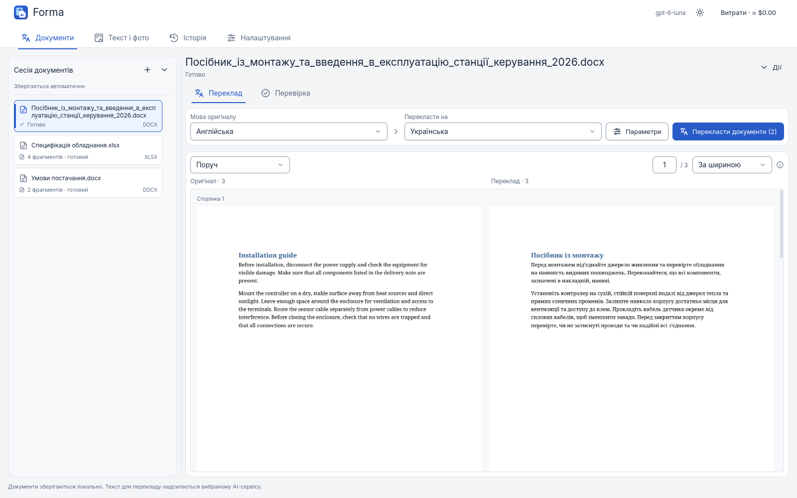
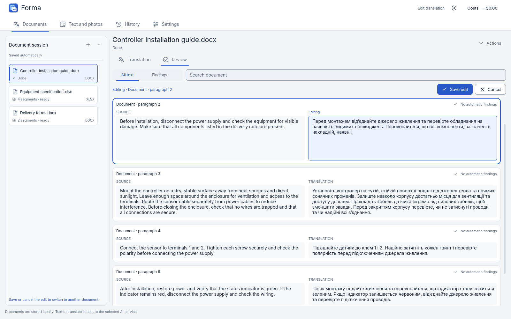
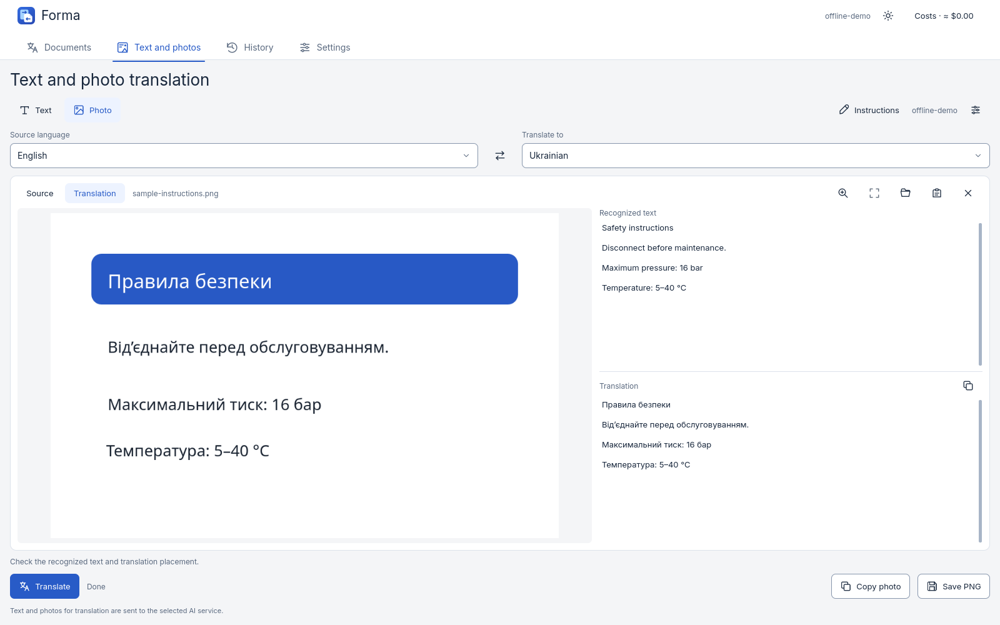

<div align="center">
  
  <h1>FormaTranslate</h1>
  <p>Translate documents, subtitles, text and photos with your own AI provider.</p>
  <p>Keep document structure. Review the result. Stay in control of your files.</p>
  <p>
    <a href="https://github.com/grebocheck/FormaTranslate/releases">Download</a> ·
    <a href="docs/GUIDE.uk.md">Українською</a> ·
    <a href="docs/BUILDING.md">Build from source</a> ·
    <a href="https://github.com/grebocheck/FormaTranslate/issues">Report an issue</a>
  </p>
</div>

FormaTranslate is an open-source desktop translator for **Windows, Linux and macOS on Apple Silicon**, built with Python and Qt Quick. Connect OpenAI, Google Gemini, Anthropic Claude or a compatible API, choose a model, and translate documents, subtitles, text or photos. API usage follows your provider's pricing and quotas; FormaTranslate itself has no subscription.

The interface supports **English, Ukrainian, Polish, German, French, Spanish, Italian, Brazilian Portuguese, Czech, Romanian, Dutch and Slovak**, follows the system language, and can be changed in Settings. Appearance follows the system by default, with explicit Light and Dark choices available without restarting. The interface language and document translation languages are independent.



Screenshots use synthetic documents and manually entered English–Ukrainian translations.

## Download and start

Get the ZIP for your platform from **[GitHub Releases](https://github.com/grebocheck/FormaTranslate/releases)** and **extract the entire archive**. Python and a `.env` file are not needed.

Version **0.17.0** provides Linux x86-64 and the complete Windows x86-64 candidate. A new macOS arm64 package is pending a native build. The earlier [0.16.1 macOS release](https://github.com/grebocheck/FormaTranslate/releases/tag/v0.16.1) does not include this release's expanded document formats or interface languages.

- **Windows:** launch `Forma-windows-x86_64.exe` from the extracted folder. Candidate builds include `candidate` in the executable name. Keep `_internal` and all other files beside the executable when moving or updating it.
- **Linux:** launch `Forma-linux-x86_64` from the extracted folder, keeping `_internal` and the other files together. If necessary, make it runnable with `chmod +x Forma-linux-x86_64`. The current Linux binary requires **glibc 2.43 or newer** (built on Ubuntu 26.04); use the source installation on older distributions.
- **macOS arm64:** the current package requires **macOS 26 or newer on Apple Silicon**. Open the extracted `Forma-macos-arm64.app`, or move the complete app to Applications. Its dependencies stay inside the app bundle. It uses ad-hoc signing and is not Developer ID signed or notarized; macOS may require explicit approval before opening it. Intel Macs are not a supported binary target.

Dependencies load from the extracted application rather than unpacking on every startup. See each release's platform validation notes for the checks performed on its downloads.

1. Open **Settings** and enter your API address, model and API key. The model list can be loaded from providers that support it, or entered manually.
2. Add DOCX, XLSX, PPTX, ODT, ODS, ODP, TXT, Markdown, HTML, SRT, WebVTT, EPUB or PDF files and select the source and target languages. **Translate** prepares scanned PDFs through OCR and continues automatically; additional PDF actions also allow preparation before translation.
3. Translate, then switch the selected document to **Review**. The same document list stays visible in both modes.

Documents form one automatically saved session. Switch files in the left sidebar; Forma remembers the selected document and each report's fragment, search and filter. Historical results opened for review join the list without being queued for another translation. **Parameters** contains terminology, memory, instructions and editorial options; **Actions** beside the document contains file and queue operations. The primary translation button shows how many pending documents it will process and does not silently rerun completed files.

One desktop or CLI translation can use a Forma data directory at a time. Close the active run before starting another with the same data; ownership is released automatically after an exit or crash. This protects the saved queue and review drafts. Read-only CLI inspection and comparison remain available.

Drag the sidebar divider to make room for long filenames. Compact document cards show their status and leave space beside the scrollbar. PDF, DOCX, PPTX, ODT and ODP support **Original**, **Translation** and **Side by side** previews with continuous scrolling through the whole document. Visible pages load on demand; zoom and a page-number field let you read details or jump directly to a page. The translation action sits beside the language and parameter controls, leaving the reading area at full available height. PDF viewing is built in. DOCX, PPTX, ODT and ODP viewing require a separately installed **LibreOffice**; pagination, slide rendering and fonts may differ from the editor that created the file. Previewing stays local and makes no translation API calls. Temporary preview copies are removed when the application closes; source and translated files remain unchanged.

**Review** shows a continuous list of source/translation pairs. Select a fragment to edit it in place, search across the document, or filter to outstanding findings. Drafts, acknowledgements and corrected-copy export keep their existing validation; switching files remains locked while an edit is open.



*Edit a fragment while keeping the surrounding source and translation visible.*

Windows and macOS each have one full application ZIP, with BabelDOC, the local OCR worker, four OCR language-model sets and Tesseract included. Extract the complete folder or `.app`; OCR and PDF engines are ready to use without installing Python, Homebrew or downloading models on first use. An installed ABBYY can still be selected on Windows; [ABBYY setup](docs/ABBYY.md) explains the supported workflows.

Release descriptions provide direct platform download links. The **Sources** archives contain the developer and dependency source materials; they are not required to run the application.

DOCX, XLSX, PPTX, ODT, ODS, ODP, TXT, Markdown, HTML, SRT, WebVTT and EPUB work directly. **Direct PDF translation uses BabelDOC; scanned PDF preparation uses the local OCR helper**. Complete Windows and macOS builds include both engines and their local assets; Linux and source installations use separate workers. See [PDF setup](docs/PDF.md), [complete Windows builds](docs/WINDOWS-RUNTIME.md) and [complete macOS builds](docs/MACOS-RUNTIME.md). Some OpenAI-compatible providers omit features used by particular API modes; choose the mode and response format supported by yours.

For a model running on your own computer, choose **LM Studio (local)** or **Ollama (local)** in Settings, load the server's model list and select an installed model. These presets fill in editable connection fields and clear old model names; they make no requests until you ask. Neither server nor translation model is bundled with Forma. Follow the [local AI setup guide in Ukrainian](docs/LOCAL-AI.uk.md) for installation, authentication and a short compatibility check.

| Local preset | Default API address |
| --- | --- |
| LM Studio (local) | `http://localhost:1234/v1` |
| Ollama (local) | `http://localhost:11434/v1` |

## Gemini and Claude

In **Settings**, choose **Google Gemini — Free Tier**, **Google Gemini**, or **Anthropic Claude**, enter the corresponding API key and save. The preset fills in the address, native API mode, model and request limits; you can edit them or load the provider's available models. Preset selection alone makes no requests and does not save a key.

The Gemini Free Tier preset starts with Flash-Lite, one request at a time and a local limit of five requests per minute. Actual model access, token/daily quotas and billing depend on your Google AI Studio project. Selecting this preset **does not disable billing** on a paid project or guarantee free access to another model. Google's free-service data handling differs from paid service; check the linked terms before using sensitive material. [Provider setup and current references](docs/PROVIDERS.md).

## Text and photo translation

Open **Text & photos** to translate text directly or paste an image from the clipboard. You can also choose an image file or drag it into the photo area. Choose the source and target languages, then click **Translate**. Nothing is sent merely by pasting.

- Text: up to 20,000 characters, translation plus editorial review, original line breaks and protected codes/links retained, and one-click copying.
- Photos: PNG/JPEG/WebP/BMP/TIFF, clipboard screenshots, original/translated preview with zoom, recognized text alongside the translation, and copy/save of the translated image as PNG.
- Uses your configured model and connection. **Photos require a vision-capable model**; ordinary text-only models cannot read them.

The photo feature reads text and its approximate position with a vision model, then draws the translation locally. It works best on clear, upright text. It does not reconstruct complex backgrounds: translated areas may use readable solid panels. Small, rotated or missed text can require another photo/crop; compare the recognized text with the original. If a block cannot fit or its estimated position overlaps another, the app explains why that area remains unchanged and keeps the full translation available as text. This is a preview to review, not pixel-perfect OCR or typesetting.

Quick text and images remain in session memory, without automatic history or cache files; saved PNGs are explicit exports. Image metadata is removed before uploading. Limits: 30 MB and 24 megapixels per input image; the API image is resized to at most 2048 pixels per side and 2 megapixels, while output retains the original dimensions.

[Details and validation](docs/TEXT-AND-PHOTOS.md).



## Custom translation instructions

Save reusable terminology and style rules with **Parameters → Custom instructions** in Documents or **Instructions** in Text & photos. They apply to future document, text/photo and editorial requests; changing them refreshes translation caches. See [instructions](docs/INSTRUCTIONS.md).

## Project translation memory

For related editable documents, open **Documents → Parameters → Project memory**, or click **Create project…** with explicit source and target languages. The memory fills automatically; a glossary and reference import are optional. **Glossary (optional)…** lets you enter terms yourself or request suggestions from the queued documents, edit the draft and click **Apply glossary**. Suggestions use your configured provider and incur its API charges. CSV import/export is an optional transfer method. **References & glossary…** also accepts verified DOCX/report pairs. This mode uses the project's fixed shared glossary for the queue; separate automatic glossaries are disabled. Memory starts **Off**, which keeps the ordinary translation workflow.

Exact source/context/policy matches can reuse completed machine results. With editorial review enabled, closely related passages can use an earlier translation as a reference for a paid adaptation request. In Review, **More actions → Remember wording → Use in project** explicitly approves a preferred translation for future runs; acknowledging a finding does not. Imported references and adapted results are not approved automatically. Conflicts require a separate replacement decision, and a running queue keeps its captured memory revision. See the [translation memory guide](docs/TRANSLATION-MEMORY.md) for matching rules, reference verification, counts and limits.

Outside project memory, automatic document terminology provides contextual suggestions. An ambiguous word can take different translations in different table or worksheet contexts; explicitly applied user terms remain binding.

## Costs and balance

The **Costs** button shows local spending estimates for today and the last 30 days, request counts and tokens. Recognized standard OpenAI models use bundled prices; other providers can use a custom model tariff. Cache reads and writes use their separate rates; small charges remain visible. Missing usage, unknown prices and incomplete historical estimates are marked explicitly. Recording starts with this update and covers only Forma requests with the current key and server.

Open the official OpenAI billing page for your actual credit balance, or enter a balance manually to track an explicitly labeled local estimate. A regular OpenAI API key cannot retrieve remaining credits through a documented public endpoint. [How accounting works and its limits](docs/COSTS.md).

## What it does

| Format | Translation and preservation |
|---|---|
| DOCX | Translates supported visible text while retaining the OOXML package, styles, tables, rich text and protected fields. |
| XLSX | Translates supported text cells and rich text while retaining formulas, native numeric cells and workbook structure. |
| PPTX | Translates text boxes, grouped shapes and table text in slide order, retaining the package, styles and media. Unsupported text surfaces are reported. |
| ODT | Translates supported text paragraphs while retaining the native OpenDocument package and protected structure. |
| ODS | Translates supported string cells while retaining formulas, numeric values and spreadsheet structure. |
| ODP | Translates supported slide text while retaining the native presentation package. |
| TXT | Translates plain-text passages while retaining the file’s encoding, line endings and protected values. |
| Markdown (`.md`, `.markdown`) | Translates supported prose while preserving markup and protected code, link destinations and metadata. |
| HTML (`.html`, `.htm`) | Translates supported body text while preserving tags, attributes and protected code. |
| SRT (`.srt`) | Translates supported caption text while retaining cue indices, timings, line breaks and protected markup. |
| WebVTT (`.vtt`) | Translates supported caption text while retaining cue IDs, timings, settings and protected metadata. |
| EPUB (`.epub`) | Translates supported book prose in spine order and human navigation labels while retaining the native package and protected resources. |
| PDF | Translate chooses text-based PDF → BabelDOC or scan → editable OCR DOCX → Office translation. Windows and macOS include both engines; Linux/source installations use separate workers. |

ODT, ODS and ODP are translated directly as native OpenDocument packages; LibreOffice conversion is not part of translation. They share the document queue, glossary, editorial checks, reports, recovery and corrected-copy export. Project-memory reuse initially binds the complete source snapshot. Reference import and explicit preferred-wording approval remain DOCX features. ODT/ODP page previews use a private inactive copy in LibreOffice; active and embedded content can be omitted from that preview while the source and translated packages retain it. ODS currently uses paired text fragments without page previews.

ODT covers supported body paragraphs and headings, table text, safe footnotes and headers/footers. ODP covers supported text in visible slides, shapes, groups and tables. Fields, comments, known code styles, hidden/deleted text, ODP notes and master/layout text, images, charts and embedded-object contents are retained without translation where excluded by the adapter. Scope findings identify these limits; ODP text-fit checks are estimates that require a visual review. Encrypted or signed OpenDocument packages and flat XML OpenDocument files are not supported. Split ODF paragraphs longer than 26,000 characters before translating. Parsing is bounded to 100,000 paragraphs and 64 MiB of expanded text; very large or complex packages may require splitting.

ODS translates supported text cells, including their rich text, while retaining formulas, cached formula results, native numeric/date/boolean values and sheet names. Repeated rows and cells stay stored as repeats: one translation applies to the represented range, without expanding it into individual cells. Explicitly hidden content stays in its source language. A cell’s `office:string-value` attribute is updated together with visible text only when it exactly matched the source paragraphs. Cells without a verified text counterpart remain untranslated with a scope notice.

TXT and Markdown accept UTF-8 with or without a byte-order mark (BOM), and UTF-16/UTF-32 with a BOM. HTML accepts UTF-8 and UTF-16 with a BOM; explicit HTML charset declarations must match the file encoding. Legacy encodings and UTF-32 HTML must be saved as UTF-8 before import. Inputs for these formats are limited to 16 MiB, four million decoded characters and 100,000 selected fragments. Each editable fragment may contain at most 20,000 characters; split longer lines or paragraphs before importing. Exports retain the original encoding, BOM and existing line endings.

TXT, Markdown and HTML use the same document queue, glossary, editorial review, reports, recovery and corrected-copy workflow. Project memory for these formats is bound to the document context; verified reference import and explicit preferred-wording approval remain DOCX features. Read the new formats as paired text fragments. Page previews are available for PDF, DOCX, PPTX, ODT and ODP.

Markdown keeps fenced and inline code, images, autolinks, reference definitions, shortcut/collapsed reference labels, YAML/TOML front matter and raw HTML blocks unchanged. Link destinations and common template expressions remain protected; ordinary inline HTML body text can be translated. When prose cannot be safely mapped back to its source, that fragment is retained and the report explains the limitation.

HTML translation covers supported body text nodes. Attributes such as `alt`, `title` and `lang`, the document head, code, scripts, styles, templates and explicitly hidden or non-translatable regions retain their source contents. SVG/MathML and embedded objects are also preserved. Common template expressions (`{{...}}`, `${...}`, ``), URLs and protected identifiers retain their source values. Forma does not load external resources or calculate visibility from external CSS; check the resulting page in your usual viewer. HTML file translation and Forma’s generated HTML reports are separate artifacts.

SRT and WebVTT translate supported caption text one cue at a time. Review and edit paired cue text in Forma; there is no video playback or page rendering. Original cue counters/IDs, timing lines, settings, line breaks and supported markup remain unchanged. Translation does not retime, renumber or reflow cues. Project memory binds the full source, including timing metadata; corrected-copy export requires the unchanged source, output and report.

SRT accepts UTF-8 with or without BOM, and BOM-marked UTF-16/UTF-32. Supported formatting includes `b`, `i`, `u`, `s`, `font` and `br`; unsupported extensions retain the whole cue with a scope notice. WebVTT requires UTF-8, with or without BOM. It supports caption styling, voice/language annotations, ruby and internal timestamp anchors. Headers and `NOTE`/`STYLE`/`REGION` blocks retain their source contents and are excluded from provider requests. Explicit metadata tracks are rejected; this is caption/subtitle support rather than a general WebVTT metadata editor.

Subtitle findings flag lines over 42 characters, more than two lines per cue or reading rates over 20 characters per second. These are approximate local readability hints, separate from translation accuracy and audiovisual synchronization. Check the result with its video in a player or subtitle editor; Forma does not automatically shorten or retime captions.

EPUB supports common EPUB 2 and EPUB 3 books with one OPF package document and local XHTML content in the spine reading order. Supported prose is extracted in that order, followed by auxiliary XHTML content and human labels in EPUB navigation and NCX. Read and edit source/translation pairs in Forma; check the exported book in a reading app. Forma does not provide an active EPUB reader, page rendering, layout fitting or audio synchronization.

The native package retains IDs, link destinations, attributes, styles, images, fonts and other protected resources. Publisher metadata, including the book title, authors, declared languages and publication identifier, stays unchanged. Code, explicitly hidden or non-translatable prose, SVG/MathML, embedded content and unsupported text surfaces remain in the source language. Recognized navigation labels can be translated even when hidden from the page flow. Scripts are not executed, resources are not fetched and CSS visibility is not computed; retained active content may still run when the book is opened in a reading app.

Recognized IDPF/Adobe font obfuscation is retained with its publication identifier; this does not remove DRM. Encrypted book content, signatures, ambiguous package roots and unsupported XML entities are rejected. XHTML/NCX content accepts UTF-8 or BOM-marked UTF-16, with matching XML declarations and known legacy DOCTYPE identifiers processed offline. Unchanged text and resources keep their source contents; translated text runs are escaped within the existing source. The package and expanded archive are limited to 512 MiB, with at most 64 MiB of XHTML/NCX resources and 100,000 book fragments. [Detailed format rules and limits](docs/GUIDE.uk.md#електронні-книги-epub).

With editorial review enabled for editable documents, Forma can make one bounded additional correction pass for remaining source prose, introduced repetition, suspicious shortening and untranslated labels across different scripts. It keeps an earlier valid version if the revision fails checks or does not improve those findings. Cached machine wording can go straight to the editor; completed checks are remembered for the same candidate and settings. Human-approved project wording is preserved. Remaining findings stay visible and are never marked as approved automatically. Disabling editorial review disables this additional work.

- Context-aware translation, terminology consistency, optional CSV glossary and an editorial pass for editable documents.
- Optional project memory for exact matches in supported editable documents, reviewed adaptation of similar passages, a shared glossary and explicitly approved wording across related documents.
- Shared API concurrency limits and a document queue, with pause/cancel controls and local progress recovery.
- Translation history, output-folder shortcuts and configurable models, including a separate editor model.
- Review with source and translation side by side, searchable findings, acknowledgements, and manual corrections for supported editable formats saved as a **new copy**.
- Local checks for changed numbers, identifiers, missing text and damaged formatting markers.

These checks help catch mistakes; they are not a score of linguistic accuracy. AI output still needs review for consequential documents. Longer translations can change pagination or overflow narrow cells and text boxes. Images embedded in documents are not translated automatically; translate individual images in Text & photos. Scan reconstruction can need OCR and table corrections before translation; it does not promise pixel-identical layout. PPTX speaker notes, master/layout text, SmartArt, chart labels and embedded-object contents are preserved without translation. Slide text expansion warnings are heuristic; review the slides in PowerPoint or LibreOffice. Encrypted/signed Office files and Strict OOXML are not supported. Word tracked changes are preserved: deleted revision text remains in its original language. See the [detailed guide](docs/GUIDE.uk.md) and [evaluation method](docs/BENCHMARK.md).

Opening **Review** refreshes local checks without API calls or changes to the document or saved report. Original HTML reports retain the findings recorded when they were created.

## Privacy and storage

Document text, typed text and images selected for translation are sent to **the API endpoint you configure**. FormaTranslate has no hosted translation backend or telemetry. A connection test makes a small API request that may be billed.

API keys can be stored in the operating system's credential vault, or kept for the current session. Preferences contain no API key. Local translation caches, reports, review drafts and project memory **can contain document text**; history stores paths and metadata. Project memory uses a separate private bilingual SQLite database. The local usage ledger stores only account hashes and request/cost metadata, never keys or document contents. Keep those files private. User databases are not bundled in releases. Data lives in the platform's Forma application-data directory; `FORMA_DATA_DIR` overrides it. An optional `.env` remains available for CLI workflows; see [.env.example](.env.example).

## Run from source

Install [uv](https://docs.astral.sh/uv/getting-started/installation/) and Python 3.11–3.13, then:

```sh
git clone https://github.com/grebocheck/FormaTranslate.git
cd FormaTranslate
uv sync --locked
uv run forma
```

```sh
uv run forma --version
uv run forma inspect examples/technical-brief.docx
uv run forma translate document.docx --source en --target uk --output results
uv run forma compare original.docx translated.docx --report results/comparison
```

The comparison command checks structure; it does not judge translation quality. Linux requires the usual Qt desktop libraries for your display system. [Build instructions and troubleshooting](docs/BUILDING.md).

## Contribute

Bug reports, translation improvements and focused pull requests are welcome. Read [CONTRIBUTING.md](CONTRIBUTING.md), the [code of conduct](CODE_OF_CONDUCT.md), [code organization](docs/ARCHITECTURE.md), [UI translation instructions](docs/I18N.md), [security reporting](SECURITY.md) and the [changelog](CHANGELOG.md). Synthetic examples are included; please do not upload confidential documents or API keys in issues.

```sh
uv sync --locked --group dev
uv run ruff check .
uv run pytest
```

Releases use semantic versioning, annotated Git tags and manual builds. There is no CI/CD pipeline. The single version source is `src/forma/__init__.py`; [release procedure](docs/RELEASING.md).

## License

FormaTranslate's original code is licensed under the **[MIT License](LICENSE)**. Qt/PySide6 and other dependencies retain their own licenses; see [third-party notices](THIRD_PARTY_NOTICES.md). Complete Windows and macOS packages include BabelDOC, OCR and model license/source materials; Linux/source workflows use separately installed engines.
