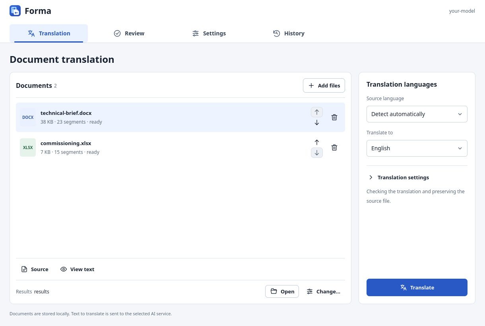
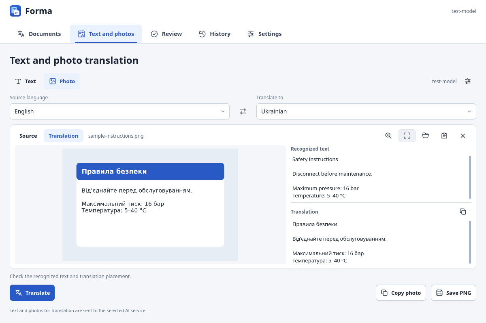

<div align="center">
  
  <h1>FormaTranslate</h1>
  <p>Translate documents, text and photos with your own AI provider.</p>
  <p>Keep document structure. Review the result. Stay in control of your files.</p>
  <p>
    <a href="https://github.com/grebocheck/FormaTranslate/releases/latest">Download</a> ·
    <a href="docs/GUIDE.uk.md">Українською</a> ·
    <a href="docs/BUILDING.md">Build from source</a> ·
    <a href="https://github.com/grebocheck/FormaTranslate/issues">Report an issue</a>
  </p>
</div>

FormaTranslate is an open-source desktop document translator for **Windows and Linux**, built with Python and Qt Quick. Connect an OpenAI or compatible API, choose a model, add documents, and translate them into another language. API usage is billed by your provider; FormaTranslate itself has no subscription.

The interface supports **English, Ukrainian, Polish and German**, follows the system language, and can be changed in Settings. The interface language and document translation languages are independent.



## Download and start

Get the package for your platform from **[GitHub Releases](https://github.com/grebocheck/FormaTranslate/releases/latest)**. Extract it and launch the executable. Python and a `.env` file are not needed for the packaged app. On Linux, make the executable runnable with `chmod +x Forma-linux-x86_64` if necessary. The 0.2.0 Linux binary requires **glibc 2.43 or newer** (built on Ubuntu 26.04); use the source installation on older distributions. See each release's platform validation notes; macOS is not supported yet.

1. Open **Settings** and enter your API address, model and API key. The model list can be loaded from providers that support it, or entered manually.
2. Add DOCX, XLSX or text-based PDF files and select the source and target languages.
3. Translate, open the output folder, and use **Review** to inspect the result.

DOCX and XLSX work directly. **PDF requires a separate BabelDOC installation**; see [PDF setup](docs/PDF.md). Some OpenAI-compatible providers omit features used by particular API modes; choose the mode and response format supported by yours.

## Text and photo translation

Open **Text & photos** to translate text directly or paste an image from the clipboard. You can also choose an image file or drag it into the photo area. Choose the source and target languages, then click **Translate**. Nothing is sent merely by pasting.

- Text: up to 20,000 characters, translation plus editorial review, original line breaks and protected codes/links retained, and one-click copying.
- Photos: PNG/JPEG/WebP/BMP/TIFF, clipboard screenshots, original/translated preview with zoom, recognized text alongside the translation, and copy/save of the translated image as PNG.
- Uses your configured model and connection. **Photos require a vision-capable model**; ordinary text-only models cannot read them.

The photo feature reads text and its approximate position with a vision model, then draws the translation locally. It works best on clear, upright text. It does not reconstruct complex backgrounds: translated areas may use readable solid panels. Small, rotated or missed text can require another photo/crop; compare the recognized text with the original. If a block cannot fit or its estimated position overlaps another, the app explains why that area remains unchanged and keeps the full translation available as text. This is a preview to review, not pixel-perfect OCR or typesetting.

Quick text and images remain in session memory, without automatic history or cache files; saved PNGs are explicit exports. Image metadata is removed before uploading. Limits: 30 MB and 24 megapixels per input image; the API image is resized to at most 2048 pixels per side and 2 megapixels, while output retains the original dimensions.

[Details and validation](docs/TEXT-AND-PHOTOS.md).



## What it does

| Format | Translation and preservation |
|---|---|
| DOCX | Translates supported visible text while retaining the OOXML package, styles, tables, rich text and protected fields. |
| XLSX | Translates supported text cells and rich text while retaining formulas, native numeric cells and workbook structure. |
| PDF | Uses BabelDOC for text extraction, layout analysis and typesetting. Text-based PDFs only; inspect the final layout visually. |

- Context-aware translation, terminology consistency, optional CSV glossary and an editorial pass for Office files.
- Shared API concurrency limits and a document queue, with pause/cancel controls and local progress recovery.
- Translation history, output-folder shortcuts and configurable models, including a separate editor model.
- Review with source and translation side by side, searchable findings, acknowledgements, and manual DOCX/XLSX corrections saved as a **new copy**.
- Local checks for changed numbers, identifiers, missing text and damaged formatting markers.

These checks help catch mistakes; they are not a score of linguistic accuracy. AI output still needs review for consequential documents. Longer translations can change pagination or overflow narrow cells and text boxes. Images embedded in documents are not translated automatically; translate individual images in Text & photos. Scanned PDFs, encrypted/signed Office files and Strict OOXML are not supported. Word tracked changes are preserved: deleted revision text remains in its original language. See the [detailed guide](docs/GUIDE.uk.md) and [evaluation method](docs/BENCHMARK.md).

## Privacy and storage

Document text, typed text and images selected for translation are sent to **the API endpoint you configure**. FormaTranslate has no hosted translation backend or telemetry. A connection test makes a small API request that may be billed.

API keys can be stored in the operating system's credential vault, or kept for the current session. Preferences contain no API key. Local translation caches, reports and review drafts **can contain document text**; history stores paths and metadata. Keep those files private. Data lives in the platform's Forma application-data directory; `FORMA_DATA_DIR` overrides it. An optional `.env` remains available for CLI workflows; see [.env.example](.env.example).

## Run from source

Install [uv](https://docs.astral.sh/uv/getting-started/installation/) and Python 3.11–3.13, then:

```sh
git clone https://github.com/grebocheck/FormaTranslate.git
cd FormaTranslate
uv sync --locked
uv run forma
```

```sh
uv run forma --version
uv run forma inspect examples/technical-brief.docx
uv run forma translate document.docx --source en --target uk --output results
uv run forma compare original.docx translated.docx --report results/comparison
```

The comparison command checks structure; it does not judge translation quality. Linux requires the usual Qt desktop libraries for your display system. [Build instructions and troubleshooting](docs/BUILDING.md).

## Contribute

Bug reports, translation improvements and focused pull requests are welcome. Read [CONTRIBUTING.md](CONTRIBUTING.md), [UI translation instructions](docs/I18N.md), [security reporting](SECURITY.md) and the [changelog](CHANGELOG.md). Synthetic examples are included; please do not upload confidential documents or API keys in issues.

```sh
uv sync --locked --group dev
uv run ruff check .
uv run pytest
```

Releases use semantic versioning, annotated Git tags and manual builds. There is no CI/CD pipeline. The single version source is `src/forma/__init__.py`; [release procedure](docs/RELEASING.md).

## License

FormaTranslate's original code is licensed under the **[MIT License](LICENSE)**. Qt/PySide6 and other dependencies retain their own licenses; see [third-party notices](THIRD_PARTY_NOTICES.md). BabelDOC is an optional, separately installed AGPL-3.0 tool and is not included in FormaTranslate packages.
